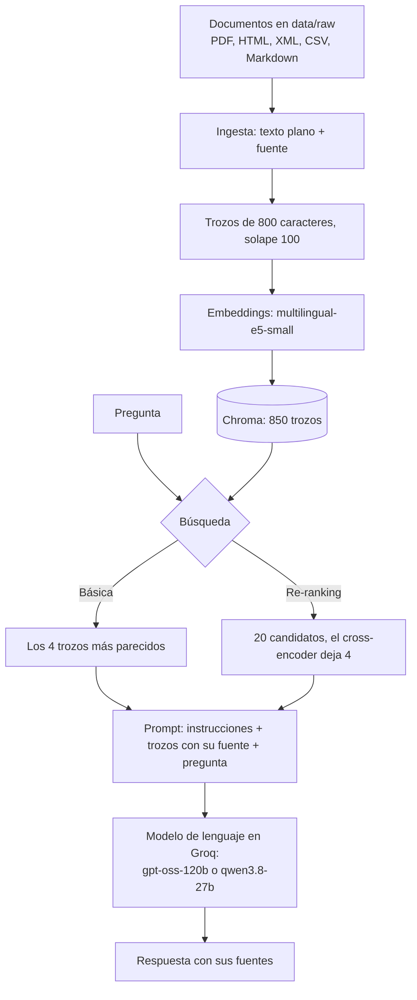
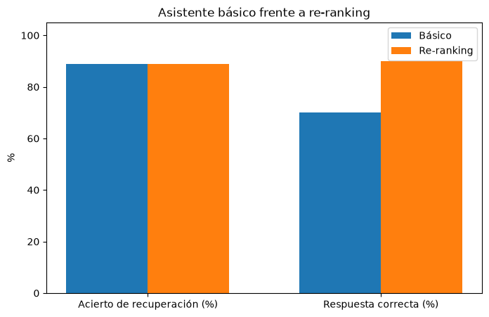
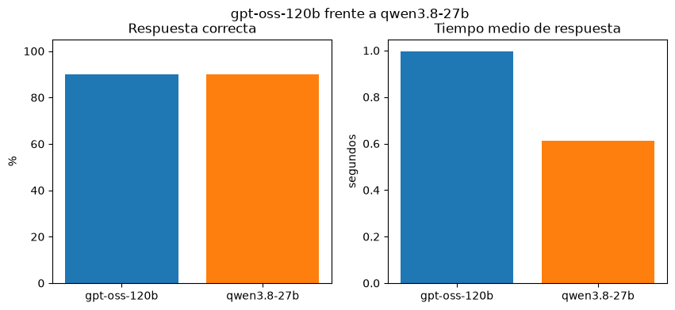

# TFM Proyecto 2 · Un asistente RAG para un taller

Un asistente que responde preguntas sobre la documentación de un taller de coches en España: normativa de talleres, ITV, llamadas a revisión, estaciones ITV y las preguntas frecuentes del propio taller. Busca la respuesta en documentos de cinco formatos distintos y dice siempre de cuál la ha sacado. Se puede usar desde los cuadernos o desde una página web: [tfm-p2-rag.streamlit.app](https://tfm-p2-rag.streamlit.app/).

## Por qué este proyecto

Trabajo en un taller de coches y me gusta la mecánica. La idea que me rondaba era reunir la información técnica del taller en un sitio al que cualquier mecánico pudiera preguntar: una guía rápida y ágil, tenga la experiencia que tenga quien la consulta.

Con la documentación de mi trabajo no pude hacerlo. Esa información es cautiva de la marca y no es fácil acceder a ella para montar un sistema así. Busqué entonces lo más parecido que fuera público: la normativa de talleres y de ITV del BOE, la página de la DGT sobre llamadas a revisión y el registro de estaciones ITV del Ministerio de Industria. Añadí unas preguntas frecuentes de un taller inventado para el proyecto, Talleres Meseta, con horarios, precios y servicios que no existen.

Elegí hacer un RAG porque me parecía interesante justo para eso. Un modelo de lenguaje no sabe nada de mis documentos, así que primero se buscan los trozos que hablan de la pregunta y después se le pide que responda solo con ellos.

## Los documentos

Están todos en data/raw/. Son siete, en cinco formatos, y al trocearlos salen 850 trozos.

| Archivo | Formato | Fuente | Trozos |
|---|---|---|---|
| rd_1457_1986_talleres_reparacion.pdf | PDF | [BOE · Real Decreto 1457/1986](https://www.boe.es/buscar/act.php?id=BOE-A-1986-18896) | 76 |
| dudas_anexo_ix_reglamento_vehiculos.pdf | PDF | [Ministerio de Industria y Turismo · ITV](https://industria.gob.es/Calidad-Industrial/vehiculos/Paginas/inspeccion-tecnica-vehiculos.aspx) | 51 |
| rd_920_2017_inspeccion_tecnica_vehiculos.html | HTML | [BOE · Real Decreto 920/2017](https://www.boe.es/buscar/act.php?id=BOE-A-2017-12841) | 287 |
| dgt_llamadas_a_revision.html | HTML | [DGT · Llamadas a revisión](https://www.dgt.es/muevete-con-seguridad/vehiculos-seguros/llamadas-a-revision/) | 10 |
| rd_920_2017_inspeccion_tecnica_vehiculos.xml | XML | [BOE · Real Decreto 920/2017 (XML)](https://www.boe.es/diario_boe/xml.php?id=BOE-A-2017-12841) | 275 |
| registro_estaciones_itv_2026.csv | CSV | [Ministerio de Industria y Turismo · Registro de estaciones ITV 2026](https://industria.gob.es/Calidad-Industrial/vehiculos/Paginas/inspeccion-tecnica-vehiculos.aspx), convertido de XLSX a CSV | 143 |
| faq_taller.md | Markdown | Elaboración propia (Talleres Meseta, ficticio) | 8 |

El Real Decreto 920/2017 está dos veces, en HTML y en XML. Lo dejé así para cubrir los dos formatos, sabiendo que 562 de los 850 trozos son contenido repetido.

## Cómo funciona



Cada formato se lee a su manera (cuaderno 01). Los PDF, con pypdf. El HTML y el XML, con BeautifulSoup, quitando menús, scripts y estilos. El CSV, con pandas, convirtiendo cada fila en una frase del tipo "La estación ITV 411 de VEIASA está en...", porque el buscador entiende mejor frases que columnas sueltas. El Markdown se lee tal cual.

Todo ese texto se parte en trozos de 800 caracteres con 100 de solape. Es el método más simple, y en 800 caracteres cabe un párrafo o una pregunta entera de la FAQ. Cada trozo se convierte en un vector y se guarda en Chroma (cuaderno 02).

Cuando llega una pregunta, se convierte también en vector y Chroma devuelve los trozos más parecidos. Esos trozos, numerados y con su fuente, van dentro del mensaje que recibe el modelo de lenguaje. Al modelo le pido dos cosas: que cite la fuente y que, si el contexto no tiene la respuesta, diga "No lo sé con la información disponible". En un taller, una respuesta inventada sobre una garantía es peor que reconocer que no se sabe.

El modelo de lenguaje es gpt-oss-120b, servido por Groq con su plan gratuito, a temperatura 0,1 para que improvise poco.

## Lo que más me costó

Los embeddings. Me costó encontrar un modelo que sirviera y, sobre todo, entender cómo funcionan de verdad.

El primero que valoré, paraphrase-multilingual-MiniLM-L12-v2, solo lee 128 tokens, y habría cortado mis trozos de 800 caracteres sin avisar. Acabé en multilingual-e5-small, que lee hasta 512, es gratuito y pequeño, y entiende español. Tiene una manía: hay que escribir query: delante de las preguntas y passage: delante de los documentos. Antes de seguir comprobé que mi trozo más largo ocupa 360 tokens, así que no se corta ninguno.

Lo que me sorprendió vino después. Una vez que tienes el modelo, usarlo es muy fácil: con unas pocas líneas cada trozo queda convertido en un vector de 384 números y Chroma se encarga de encontrar los parecidos. Las herramientas de IA me ayudaron mucho a entender qué estaba pasando ahí dentro.

## Lo que fui probando

### El asistente básico

Lo probé con cinco preguntas (cuaderno 03). Acertó la periodicidad de la ITV, qué hacer con una llamada a revisión y lo del presupuesto por escrito. A una pregunta que no tenía nada que ver, quién ganó el Mundial de 2010, contestó que no lo sabía, que es lo que tiene que hacer.

```
Pregunta: ¿El taller está obligado a darme un presupuesto por escrito antes de reparar el coche?

Sí, el taller está obligado a entregarte un presupuesto por escrito antes de iniciar la reparación. Según el Real Decreto 1457/1986, todo cliente tiene derecho a un presupuesto escrito con una validez mínima de doce días hábiles, y la reparación solo comienza cuando lo firmas o renuncias por escrito a que se haga.

Fuentes: faq_taller.md; rd_1457_1986_talleres_reparacion.pdf
```

Falló en la que mejor conozco, porque soy de allí: las estaciones ITV de Valladolid. Listó seis de las siete. Faltaba la de Peñafiel, y no por culpa del modelo: el trozo donde aparece no estaba entre los cuatro que le llegaron.

### El re-ranking

Como el fallo estaba en la búsqueda, la mejora tenía que ir ahí (cuaderno 04). El modelo e5 convierte la pregunta y los trozos en vectores por separado. Es rápido, pero nunca los lee juntos. Un cross-encoder sí lee la pregunta y el trozo a la vez y les pone una nota, a cambio de ser más lento. Combiné los dos: e5 trae 20 candidatos, el cross-encoder los ordena y me quedo con los 4 mejores. Usé mmarco-mMiniLMv2-L12-H384-v1, que pesa unos 470 MB; la alternativa que miré, bge-reranker-v2-m3, pasa de 2 GB.

Para medirlo preparé 10 preguntas con su respuesta comprobada contra los documentos, y dos medidas: si la búsqueda trae el trozo que contiene el dato, y si la respuesta es correcta según un modelo que hace de juez.

| | Básico | Con re-ranking |
|---|---|---|
| La búsqueda trae el trozo correcto (de 9 preguntas) | 8 | 8 |
| Respuesta correcta según el juez (de 10 preguntas) | 7 | 9 |



Con re-ranking entra el trozo de Peñafiel y la respuesta de Valladolid sale completa. La de Utrera falla en las dos versiones: su trozo no aparece ni entre los 20 candidatos, y el re-ranking solo puede reordenar lo que ya se ha encontrado.

Hay un detalle que conviene contar. De las tres respuestas que el juez dio por malas en la versión básica, una, la del plazo para reparar los defectos leves, dice lo mismo que la de la versión con re-ranking, que sí dio por buena. El juez se contradijo. Contando esa como correcta, el básico acierta 8 de 10 y la mejora real es de una sola pregunta. Con 10 preguntas, una de diferencia no demuestra gran cosa.

### Otro modelo

En la tutoría, mi tutor me preguntó si había probado más modelos. No lo había hecho, así que lo hice (cuaderno 05). Dejé fija la búsqueda con re-ranking y cambié solo el modelo: frente a gpt-oss-120b puse qwen3.8-27b, de otra familia y unas cuatro veces más pequeño. No había mucho donde elegir, porque en el plan gratuito de Groq no hay ningún Llama de chat; solo los ofrecen a cuentas Enterprise.

| | gpt-oss-120b | qwen3.8-27b |
|---|---|---|
| Respuesta correcta (de 10 preguntas) | 9 | 9 |
| Tiempo medio por respuesta | 1,00 s | 0,61 s |
| Tiempo mediano | 0,91 s | 0,38 s |
| Tokens de salida, de media | 245 | 78 |



Empate en acierto. Los dos fallan solo Utrera, que vuelve a ser un fallo de la búsqueda y no del modelo. El pequeño es más rápido porque escribe menos: gpt-oss-120b razona antes de contestar y da respuestas más completas, y qwen3.8-27b va al grano. En la app dejé gpt-oss-120b como opción por defecto porque qwen3.8-27b está en fase de pruebas en Groq y pueden retirarlo, pero en estas preguntas el pequeño hace el mismo trabajo.

### Quién califica

Lo que más vueltas dio de esa comparación fue el juez. En el cuaderno 04 calificaba el propio gpt-oss-120b, y aquí era uno de los dos que competían. No me parecía bien que se pusiera nota a sí mismo, así que busqué otro, con la condición de que fuera gratuito.

Estuve valorando Jev, de TypeSafe, un modelo que no escribe texto: recibe una pregunta cerrada y devuelve la probabilidad de que la respuesta sea sí. Su API no es gratuita, así que no me servía. Probé entonces con el modelo gratuito más capaz de Google, Gemini 4 Hydrogen, y el cuaderno se quedaba colgado sin dar ningún error. Costó dar con el motivo: el plan gratuito solo permite 20 peticiones al día, justo las que gasta una evaluación, y la librería de Google reintenta los errores por su cuenta sin avisar.

Al final califican dos jueces. El principal es Gemini 3.5 Flash-Lite, con el mismo criterio que en el cuaderno 04. El segundo es Gemini Decision 1, un modelo del mismo tipo que Jev que Google publicó el 11 de noviembre de 2026 y que sí tiene nivel gratuito. Coincidieron en las 20 respuestas.

## La app

Con el asistente funcionando en los cuadernos, quise llevarlo un paso más allá: una página web donde cualquiera pueda hacerle preguntas sin abrir un cuaderno. Está hecha con Streamlit, en app.py.

Deja elegir el modelo. Debajo de cada respuesta enseña los fragmentos que se han usado y de qué documento sale cada uno. Y tiene un modo que lanza la misma pregunta a los dos modelos y pone las respuestas una al lado de la otra, con lo que ha tardado cada uno. Está pensada también para el móvil, donde las respuestas salen una debajo de otra.

Elegí Streamlit frente a Gradio porque se despliega gratis desde el propio repositorio de GitHub y porque es la herramienta habitual para paneles de datos, así que me sirve para más cosas.

Está desplegada en Streamlit Community Cloud desde la rama main, en [tfm-p2-rag.streamlit.app](https://tfm-p2-rag.streamlit.app/). Si lleva un rato sin visitas aparece dormida: hay que pulsar el botón que sale y esperar un par de minutos. La clave de Groq no está en el repositorio: va en los secrets del servicio. Como la base vectorial no se sube a GitHub, la app desplegada usa una copia guardada en chroma_db_nube.

## Tropiezos por el camino

Al leer el XML del BOE me salía un solo trozo. La búsqueda de la etiqueta texto se metía también en los niveles de dentro, donde están las referencias a otras normas. Se arregló pidiéndole que buscara solo en el primer nivel.

En la evaluación, Groq empezó a devolver el error 429. El plan gratuito permite 8.000 tokens por minuto y las llamadas seguidas lo superaban. Puse una pausa de 15 segundos después de cada llamada, y por eso el cuaderno 04 tarda unos 11 minutos.

Renombré la carpeta del proyecto y el entorno virtual dejó de funcionar. Un .venv lleva su ruta escrita dentro y no se puede mover de sitio, así que hubo que crearlo de nuevo.

El despliegue tampoco salió a la primera: la app daba un fallo con la clave de Groq y hubo que retocar cómo la lee.

Y lo del juez de Google, que ya he contado arriba, fue el que más tiempo se llevó.

## Lo que no hace bien

La pregunta de Utrera no la acierta ninguna versión. Al trocear el CSV por caracteres, cada trozo mezcla varias estaciones y la que busco se diluye entre las demás.

Diez preguntas son pocas. Las diferencias que salen son de una respuesta, y con eso no se puede afirmar que una versión sea mejor en general.

El modelo no contesta exactamente igual cada vez, aunque la temperatura sea baja, y la lista de 20 candidatos de la búsqueda también cambia un poco de una ejecución a otra.

Los jueces son modelos y se equivocan, como se vio en el cuaderno 04. Por eso los cuadernos enseñan todas las respuestas, para poder revisarlas a mano.

La app desplegada es pública y gasta la cuota gratuita de mi clave de Groq, y se duerme cuando lleva horas sin visitas. Su base vectorial es una copia hecha a mano: si se vuelve a ejecutar el cuaderno 02, hay que rehacerla.

## Cómo ejecutarlo

Está probado con Python 3.14.

```
python3 -m venv .venv
source .venv/bin/activate
pip install -r requirements.txt
```

Hacen falta dos claves gratuitas. Se copia el archivo .env.example con el nombre .env y se pegan detrás del signo igual. El archivo .env no se sube a GitHub.

- GROQ_API_KEY, de [console.groq.com](https://console.groq.com). La usan los cuadernos 03, 04 y 05 y la app.
- GEMINI_API_KEY, de [aistudio.google.com](https://aistudio.google.com). Solo la usa el cuaderno 05, para los jueces.

Los cuadernos se ejecutan en orden, del 01 al 05, con el kernel del .venv. El 01 crea data/processed/chunks.csv y el 02 crea chroma_db/, que necesitan los siguientes. El 04 tarda unos 11 minutos y el 05 unos 10, por las pausas. Se entregan ya ejecutados, con sus salidas, para poder leerlos sin lanzarlos.

La app se arranca así y se abre sola en el navegador:

```
streamlit run app.py
```

Funciona nada más clonar el repositorio, sin ejecutar antes los cuadernos, porque si no encuentra chroma_db usa la copia de chroma_db_nube. Solo necesita la clave de Groq.

Esto es lo que hay en el repositorio:

```
tfm-p2-RAG/
├── data/
│   ├── raw/                  # los 7 documentos originales
│   └── processed/            # chunks.csv (no se sube; lo crea el cuaderno 01)
├── chroma_db/                # base vectorial (no se sube; la crea el cuaderno 02)
├── chroma_db_nube/           # copia de la base para la app desplegada
├── models/                   # vacía (los modelos se descargan de Hugging Face)
├── notebooks/
│   ├── 01_ingesta.ipynb
│   ├── 02_embeddings_chroma.ipynb
│   ├── 03_asistente_basico.ipynb
│   ├── 04_reranking_evaluacion.ipynb
│   └── 05_comparacion_modelos.ipynb
├── outputs/                  # gráficos de los cuadernos 04 y 05
├── app.py                    # la app de chat
├── estilo.css                # diseño de la app
├── .streamlit/config.toml    # colores y tipografía de la app
├── .env.example              # plantilla para las claves
├── requirements.txt
└── README.md
```

## Cómo he usado la IA

He usado un asistente de IA durante todo el proyecto. Me ha servido para llevar el guion del trabajo, para escribir código y para ayudarme a decidir. Las decisiones las he tomado yo, y a partir de ellas la he ido guiando. Fue cosa mía, por ejemplo, no dejar que un modelo se calificara a sí mismo y buscar otro juez, o desplegar la app desde la rama main y no desde la de trabajo.

Hasta que no tenía algo claro y bien explicado, no lo daba por bueno. Esas explicaciones están en los propios cuadernos.

También me ayudó a buscar qué modelos gratuitos podía usar. Y me ha gustado poder llevar el proyecto un paso más allá gracias a ella, con la pequeña página web para hacer preguntas y comparar los modelos.

## Si siguiera con ello

Si empezara de cero lo haría parecido. Lo que cambiaría está en la búsqueda, que es donde se pierden las respuestas: trocear el CSV con una estación por trozo en lugar de por caracteres, quitar el duplicado del Real Decreto 920/2017 y preparar más preguntas de evaluación, para que las diferencias sean de fiar.

Lo que de verdad me gustaría es usarlo con la información técnica de un taller, para que cualquier mecánico tenga esa guía rápida. Hoy no puedo, porque esa información es cautiva de la marca.
