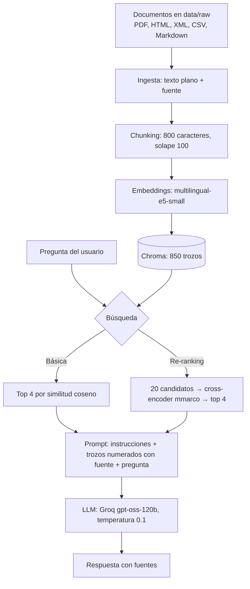
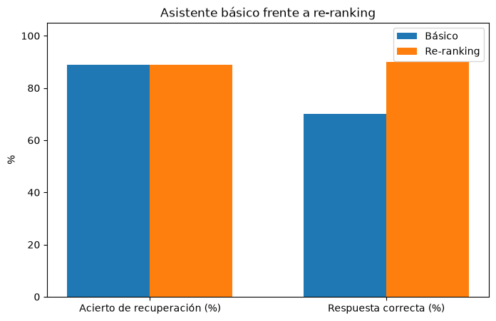

# 🔧 TFM Proyecto 2 · Asistente RAG multiformato para un taller

Asistente que responde preguntas sobre la documentación de un taller de reparación de vehículos en España (normativa de talleres, ITV, llamadas a revisión, estaciones ITV y preguntas frecuentes del taller) a partir de documentos en **5 formatos distintos**.

---

## 📑 Tabla de contenidos

1. [Objetivo](#-objetivo)
2. [Documentos](#-documentos)
3. [Estructura del repositorio](#️-estructura-del-repositorio)
4. [Esquema del flujo](#-esquema-del-flujo)
5. [Preguntas del enunciado](#-preguntas-del-enunciado)
6. [Asistente básico](#-asistente-básico)
7. [Versión mejorada](#-versión-mejorada)
8. [Evaluación](#-evaluación)
9. [Ejemplo de ejecución](#-ejemplo-de-ejecución)
10. [Cómo ejecutar](#️-cómo-ejecutar)
11. [Limitaciones](#️-limitaciones)
12. [Mejoras futuras](#-mejoras-futuras)
13. [Lecciones aprendidas](#-lecciones-aprendidas)
14. [Uso de la IA](#-uso-de-la-ia)

---

## 🎯 Objetivo

Un taller recibe a diario las mismas dudas de sus clientes: garantías, presupuestos, plazos de la ITV, llamadas a revisión o qué estación ITV le queda más cerca. El objetivo es un asistente que responda a esas preguntas buscando la información en la documentación del taller y en la normativa oficial, y que indique de qué documento la ha sacado.

La temática es un taller de reparación y venta de vehículos. Junto a documentos oficiales reales (BOE, DGT y Ministerio de Industria), el proyecto incluye la FAQ de **Talleres Meseta**, un taller ficticio de Valladolid creado para el proyecto, con horarios, precios y servicios inventados.

---

## 📚 Documentos

Todos los documentos están en data/raw/.

| Archivo | Formato | Fuente | Tipo |
|---|---|---|---|
| rd_1457_1986_talleres_reparacion.pdf | PDF | [BOE · Real Decreto 1457/1986](https://www.boe.es/buscar/act.php?id=BOE-A-1986-18896) | Real |
| dudas_anexo_ix_reglamento_vehiculos.pdf | PDF | [Ministerio de Industria y Turismo · ITV](https://industria.gob.es/Calidad-Industrial/vehiculos/Paginas/inspeccion-tecnica-vehiculos.aspx) | Real |
| rd_920_2017_inspeccion_tecnica_vehiculos.html | HTML | [BOE · Real Decreto 920/2017](https://www.boe.es/buscar/act.php?id=BOE-A-2017-12841) | Real |
| dgt_llamadas_a_revision.html | HTML | [DGT · Llamadas a revisión](https://www.dgt.es/muevete-con-seguridad/vehiculos-seguros/llamadas-a-revision/) | Real |
| rd_920_2017_inspeccion_tecnica_vehiculos.xml | XML | [BOE · Real Decreto 920/2017 (XML)](https://www.boe.es/diario_boe/xml.php?id=BOE-A-2017-12841) | Real |
| registro_estaciones_itv_2026.csv | CSV | [Ministerio de Industria y Turismo · Registro de estaciones ITV 2026](https://industria.gob.es/Calidad-Industrial/vehiculos/Paginas/inspeccion-tecnica-vehiculos.aspx) (convertido de XLSX a CSV) | Real |
| faq_taller.md | Markdown | Elaboración propia (Talleres Meseta, ficticio) | Inventado |

En total, 7 documentos en 5 formatos que dan **850 trozos**:

| Documento | Trozos |
|---|---|
| rd_920_2017_inspeccion_tecnica_vehiculos.html | 287 |
| rd_920_2017_inspeccion_tecnica_vehiculos.xml | 275 |
| registro_estaciones_itv_2026.csv | 143 |
| rd_1457_1986_talleres_reparacion.pdf | 76 |
| dudas_anexo_ix_reglamento_vehiculos.pdf | 51 |
| dgt_llamadas_a_revision.html | 10 |
| faq_taller.md | 8 |

---

## 🗂️ Estructura del repositorio

```
tfm-p2/
├── data/
│   ├── raw/                  # los 7 documentos originales
│   └── processed/            # chunks.csv con los trozos (no se sube)
├── chroma_db/                # base vectorial de Chroma (no se sube; la crea el cuaderno 02)
├── models/                   # vacía (los modelos se descargan de Hugging Face)
├── notebooks/
│   ├── 01_ingesta.ipynb
│   ├── 02_embeddings_chroma.ipynb
│   ├── 03_asistente_basico.ipynb
│   └── 04_reranking_evaluacion.ipynb
├── outputs/
│   └── comparativa_reranking.png
├── .env.example              # plantilla para la clave de Groq
├── requirements.txt
└── README.md
```

---

## 🔀 Esquema del flujo



---

## ❓ Preguntas del enunciado

**¿Qué formatos se han usado?** Cinco: PDF (pypdf), HTML y XML (BeautifulSoup), CSV (pandas) y Markdown (lectura directa). En el HTML se eliminan scripts, estilos y menús; en el XML del BOE se toma solo la etiqueta texto del primer nivel, para no mezclar las referencias a otras normas. Cada fila del CSV se convierte en una frase ("La estación ITV 411 de VEIASA está en..."), porque el buscador entiende mejor frases que columnas sueltas.

**¿Cómo se ha hecho el chunking?** Por número de caracteres: trozos de 800 caracteres (chunk_size) con 100 de solape (chunk_overlap). 800 caracteres da para un párrafo o una pregunta de la FAQ completa, y el trozo más largo ocupa 360 tokens, por debajo del máximo de 512 del modelo de embeddings, así que ninguno se corta. El solape de 100 evita perder una idea que caiga justo en el corte entre dos trozos. Es el método más sencillo y suficiente para una primera versión.

**¿Qué modelo y qué base vectorial?**
- Embeddings: **intfloat/multilingual-e5-small** (gratuito, ligero, multilingüe y vectores de 384 números). Se eligió frente a paraphrase-multilingual-MiniLM-L12-v2 porque este solo lee 128 tokens y cortaría los trozos.
- Base vectorial: **Chroma** con PersistentClient, guardada en disco y con similitud por coseno.
- LLM: **openai/gpt-oss-120b** en Groq (plan gratuito). En Groq no hay ningún Llama de chat disponible; este modelo de pesos abiertos escribe bien en español.
- Re-ranking: **cross-encoder/mmarco-mMiniLMv2-L12-H384-v1**, multilingüe y entrenado para búsqueda. Se eligió frente a BAAI/bge-reranker-v2-m3 porque pesa unos 470 MB frente a más de 2 GB.

**¿Cómo se ha evaluado?** Con 10 preguntas con respuesta de referencia comprobada a mano y dos métricas: acierto de recuperación (si algún trozo recuperado viene de la fuente correcta y contiene el dato clave) y respuesta correcta (un LLM como juez compara con la referencia). Detalle en [Evaluación](#-evaluación).

**¿Qué mejora se ha probado?** Re-ranking con un cross-encoder. Detalle en [Versión mejorada](#-versión-mejorada).

**¿Qué se ha aprendido?** Ver [Lecciones aprendidas](#-lecciones-aprendidas).

---

## 🤖 Asistente básico

Cuaderno 03. El asistente sigue las tres fases de RAG:

1. **Recuperación:** la pregunta (con el prefijo query:) se convierte en embedding y Chroma devuelve los 4 trozos más parecidos.
2. **Aumento:** los trozos se numeran con su fuente y se juntan con la pregunta en el prompt.
3. **Generación:** gpt-oss-120b responde con temperatura 0.1. El prompt de sistema le pide citar la fuente y decir "No lo sé con la información disponible" si el contexto no tiene la respuesta.

En las 5 preguntas de prueba acierta la ITV, la llamada a revisión y el presupuesto, y responde "No lo sé" a la pregunta fuera de tema. En la de estaciones de Valladolid lista 6 de las 7: falta la 4705 de Peñafiel, porque su trozo no estaba entre los 4 recuperados. El fallo está en la búsqueda, no en el LLM.

---

## 🚀 Versión mejorada

Cuaderno 04. La mejora está en la búsqueda: **re-ranking**.

- El modelo e5 es un **bi-encoder**: codifica la pregunta y los trozos por separado. Es muy rápido, pero nunca los lee juntos.
- Un **cross-encoder** lee la pregunta y el trozo juntos y les da una puntuación de relevancia. Es más preciso, pero más lento.

Se combinan los dos: e5 trae 20 candidatos, el cross-encoder los puntúa y se quedan los 4 mejores. El prompt y el LLM son los mismos que en la versión básica, así que la comparación solo mide el cambio en la búsqueda.

---

## 📊 Evaluación

10 preguntas variadas: FAQ del taller, Real Decreto de talleres, Real Decreto de ITV, página de la DGT, CSV de estaciones (Valladolid y Utrera) y una pregunta fuera de tema.

| Métrica | Básico (k=4) | Re-ranking (20 → 4) |
|---|---|---|
| Acierto de recuperación (sobre 9) | 88,9 % | 88,9 % |
| Respuesta correcta (sobre 10) | 80 % | 90 % |



- La recuperación empata: las dos versiones fallan solo Utrera.
- El re-ranking acierta una respuesta más, la de Valladolid, porque mete en los 4 trozos el de Peñafiel.
- La pregunta fuera de tema: las dos versiones responden "No lo sé".
- Al revisar las 20 respuestas a mano, las calificaciones coinciden con las del juez.

La mejora es pequeña (una pregunta) y hay que tomarla con prudencia (ver [Limitaciones](#️-limitaciones)).

---

## 💡 Ejemplo de ejecución

Salida real del cuaderno 03:

```
Pregunta: ¿El taller está obligado a darme un presupuesto por escrito antes de reparar el coche?

Sí, el taller está obligado a entregarte un presupuesto por escrito antes de iniciar la reparación. Según el Real Decreto 1457/1986, todo cliente tiene derecho a un presupuesto escrito con una validez mínima de doce días hábiles, y la reparación solo comienza cuando lo firmas o renuncias por escrito a que se haga.

Fuentes: faq_taller.md; rd_1457_1986_talleres_reparacion.pdf

Fuentes recuperadas: ['faq_taller.md', 'rd_1457_1986_talleres_reparacion.pdf', 'faq_taller.md', 'rd_1457_1986_talleres_reparacion.pdf']
```

Y con una pregunta fuera de tema:

```
Pregunta: ¿Quién ganó el Mundial de fútbol de 2010?

No lo sé con la información disponible.
```

---

## ▶️ Cómo ejecutar

1. Crear el entorno virtual e instalar las dependencias:

```
python3 -m venv .venv
source .venv/bin/activate
pip install -r requirements.txt
```

2. Clave gratuita de Groq (necesaria desde el cuaderno 03):
   1. Crear una cuenta gratuita en [console.groq.com](https://console.groq.com) y generar una clave en el apartado API Keys.
   2. Copiar el archivo .env.example de la raíz del proyecto con el nombre .env.
   3. Pegar la clave en .env, detrás de GROQ_API_KEY=. El archivo .env no se sube a GitHub.

3. Abrir los cuadernos con el kernel del .venv y ejecutarlos en orden: 01 → 02 → 03 → 04. El 01 crea data/processed/chunks.csv y el 02 crea la base chroma_db/; los dos siguientes los necesitan.

4. El cuaderno 04 tarda unos **11 minutos**: el plan gratuito de Groq permite unos 8.000 tokens por minuto, así que hay una pausa de 15 segundos tras cada llamada para no recibir el error 429.

Los cuadernos se entregan ya ejecutados, con sus salidas, para poder leerlos sin volver a ejecutarlos. Los modelos de Hugging Face se descargan solos la primera vez.

---

## ⚠️ Limitaciones

- **Documento duplicado:** el Real Decreto 920/2017 está en HTML y en XML, que son 562 de los 850 trozos. Se incluyó para cubrir los dos formatos, pero ocupa sitio en los resultados con información repetida.
- **Utrera:** el trozo con la estación 4131 no entra ni entre los 20 candidatos, así que el re-ranking no puede rescatarlo. Al trocear el CSV por caracteres, cada trozo mezcla varias estaciones y su embedding se diluye.
- **Pocas preguntas:** con 10 preguntas, la diferencia es de una sola respuesta; no basta para afirmar que el re-ranking es mejor en general.
- **Variabilidad del LLM:** aunque la temperatura sea 0.1, el modelo no responde exactamente igual cada vez. En una ejecución anterior del ejemplo de Valladolid, la versión con re-ranking también se dejó Peñafiel.
- **Métrica generosa:** en Valladolid cuenta como acierto de recuperación que aparezca cualquier estación de la provincia, aunque falte alguna.
- **Juez automático:** el mismo LLM califica las respuestas; se revisaron a mano, pero en un conjunto grande no sería posible.

---

## 🔭 Mejoras futuras

- Trocear el CSV con **un trozo por fila** (una estación por trozo), en lugar de por 800 caracteres.
- **Quitar el duplicado** HTML/XML del Real Decreto 920/2017, o deduplicar los trozos repetidos.
- **Más preguntas** de evaluación, para que las diferencias sean fiables.
- Un juez más robusto, tipo Jev de TypeSafe, que dé además una **confianza calibrada** en cada calificación.
- Probar trozos más pequeños, **500 caracteres con 50 de solape**, y comparar con 800/100.

---

## 🎓 Lecciones aprendidas

- En un RAG, la mayoría de los fallos vienen de la **búsqueda**: si el trozo correcto no llega al prompt, el LLM no puede responder bien (Valladolid, Utrera).
- La forma de preparar cada formato importa tanto como el modelo: convertir las filas del CSV en frases o quedarse solo con el texto del XML cambia lo que se puede encontrar.
- El re-ranking solo **reordena** lo que ya trajo la primera búsqueda; no encuentra lo que no está entre los candidatos.
- Pedir al modelo que cite la fuente y que diga "No lo sé" hace las respuestas comprobables y evita inventos.
- Medir con un conjunto de preguntas fijo es necesario para saber si un cambio mejora, y hay que interpretar el resultado con prudencia cuando el conjunto es pequeño.
- Con servicios gratuitos hay que contar con sus límites (aquí, los tokens por minuto de Groq).

---

## 💬 Uso de la IA

En este proyecto he usado un asistente de IA como apoyo para escribir código, resolver errores y mantener la documentación. Las decisiones del proyecto y la revisión de cada resultado son mías. Cuando aparecía algo nuevo para mí (por ejemplo el re-ranking con cross-encoder o el uso de un LLM como juez), lo pedía explicado y no lo daba por bueno hasta entenderlo; esas explicaciones están en los propios cuadernos.
